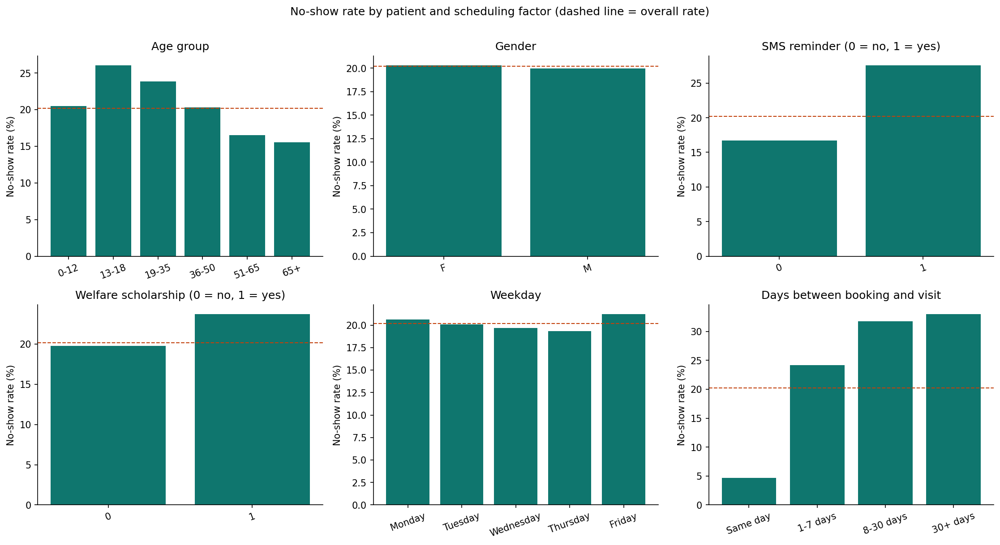
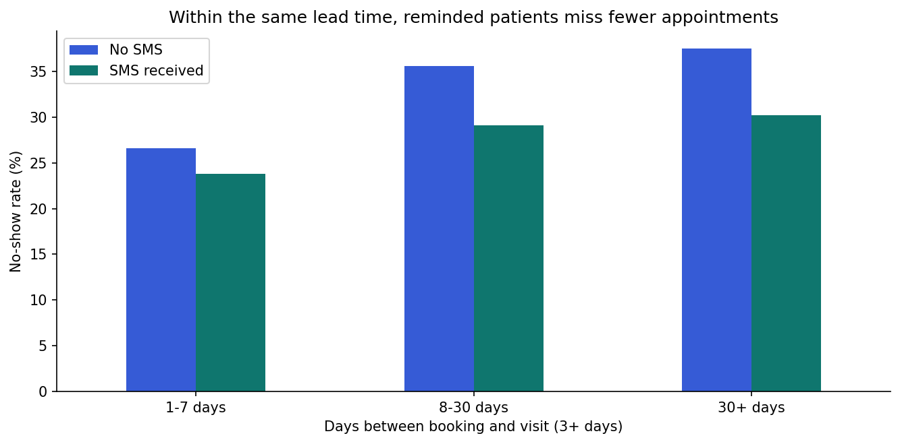
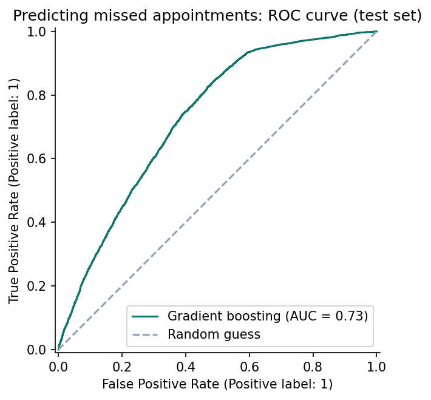
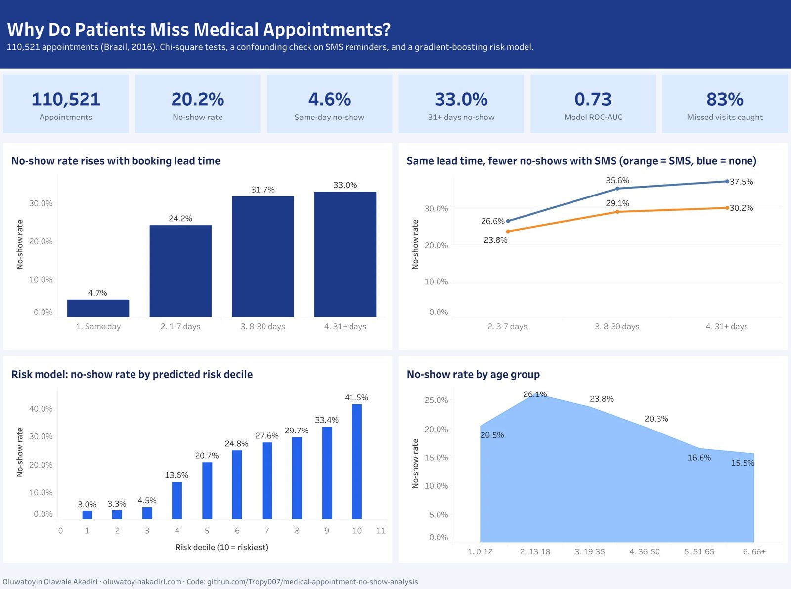

# Why Do Patients Miss Medical Appointments?

Analysis of **110,527 medical appointments** to find which patient and scheduling factors are linked to no-shows, test which differences are statistically significant, uncover a confounding effect, and build a model that ranks appointments by no-show risk.

**Author:** Oluwatoyin Olawale Akadiri · [Portfolio](https://oluwatoyinakadiri.com) · [LinkedIn](https://www.linkedin.com/in/oluwatoyin-akadiri/)

## Results at a glance

| Finding | Evidence |
|---|---|
| Overall no-show rate | **20.2%** of appointments missed |
| Strongest driver: booking lead time | **4.6%** no-show for same-day vs **33.0%** for 30+ days ahead (χ² test, p < 0.001) |
| SMS reminder paradox | Reminded patients look worse overall (27.6% vs 16.7%), but **within each lead-time band they miss fewer appointments** |
| Not meaningful | Gender (p = 0.17) and alcoholism show no meaningful difference |
| Risk model (gradient boosting, held-out test set) | **ROC-AUC 0.73**, catches **83%** of missed appointments; the riskiest 20% of bookings have a **37.4%** no-show rate (1.9× average) |

## Key findings

1. **Lead time matters most.** The longer the gap between booking and visit, the more likely the patient misses it.
2. **Beware confounding.** SMS reminders are sent only for appointments booked days ahead, which are already riskier. Comparing like with like shows reminders are associated with *lower* no-show rates.
3. **Accuracy is the wrong metric here.** Predicting "attended" for everyone already scores about 80%. The model is judged on ROC-AUC and recall, which reflect its real value: focusing reminder calls where they help most.







## Recommendations

- Offer shorter booking windows or confirmation calls for appointments booked weeks ahead.
- Keep SMS reminders, and prioritize them for the highest-risk bookings flagged by the model.
- Treat findings as associations to test (for example with an A/B test of reminder timing), not as proven causes.

## Interactive dashboard

[](https://public.tableau.com/app/profile/oluwatoyin.akadiri6432/viz/Appointment_No_Show_Dashboard/AppointmentNo-Shows)

**[Open the interactive dashboard on Tableau Public](https://public.tableau.com/app/profile/oluwatoyin.akadiri6432/viz/Appointment_No_Show_Dashboard/AppointmentNo-Shows)**

The packaged workbook is [`dashboard/Appointment_No_Show_Dashboard.twbx`](dashboard/Appointment_No_Show_Dashboard.twbx). [`dashboard/export_dashboard_data.py`](dashboard/export_dashboard_data.py) rebuilds the dashboard tables in `dashboard/data/` from this project's data and code.

## Methods

- Data cleaning: invalid ages and bookings dated after the appointment removed
- Feature engineering: lead time, age groups, weekday, booking hour
- Chi-square tests of independence and a Mann-Whitney U test, with effect sizes
- Stratified comparison to expose confounding
- Logistic regression and gradient boosting with class weighting, 5-fold cross-validation, ROC-AUC and recall

## Project structure

```
medical-appointment-no-show-analysis/
├── notebooks/medical_appointment_no_show_analysis.ipynb   # full analysis with outputs
├── src/descriptive_charts.py                              # standalone script for the six descriptive charts
├── images/                                                # charts used in this README
├── data/README.md                                         # where to download the data
├── requirements.txt
└── README.md
```

## How to run

```bash
git clone https://github.com/Tropy007/medical-appointment-no-show-analysis.git
cd medical-appointment-no-show-analysis
pip install -r requirements.txt
# download KaggleV2-May-2016.csv into data/ (see data/README.md)
jupyter notebook notebooks/medical_appointment_no_show_analysis.ipynb
```

## Data and limitations

Public Kaggle dataset of appointments in Vitória, Brazil (2016). It does not record reasons for missing, and repeat visits by the same patient are not modelled. The analysis is descriptive and predictive, not causal, and is not a clinical tool.
